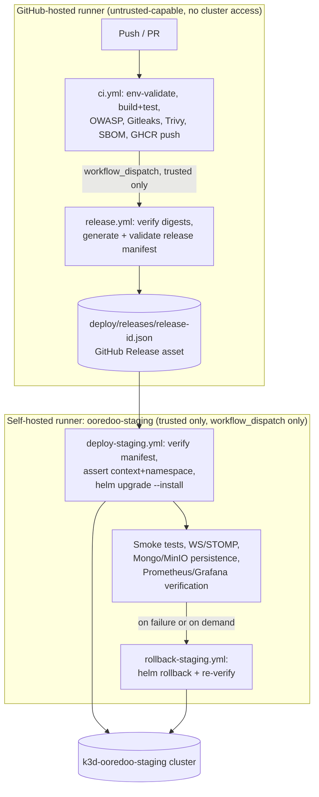

# Release architecture, CI/CD, rollback, and incident history (Phase 5)

## 1. Release architecture overview

Three repos (backend, frontend, OCR) each build and push their own
image independently — no central orchestrator builds anything. `release.yml`
lives only in the backend repo and never rebuilds; it only verifies
already-published digests and assembles the manifest that names all
three. This was a deliberate choice over a central-build orchestrator:
each repo's own `ci.yml` already owns its build/test/scan/SBOM/push
pipeline (proven since Phase 1), and duplicating that logic centrally
would mean two places could disagree about how an image was built.

## 2. Branch, tag, and digest strategy

- **Feature branches**: run CI (build/test/scan) only. Never publish a
  production-tagged image, never deploy.
- **`develop`**: intended to trigger a staging release once merged (not
  exercised as an automatic merge-triggered flow this phase — see §7's
  open item on `workflow_dispatch` requiring the workflow file to exist
  on the default branch first).
- **`main`**: stable branch. No automatic production deploy exists or is
  planned to exist automatically this phase.
- **Release tags** (`vMAJOR.MINOR.PATCH`): may produce
  production-ready artifacts (this is how the frontend/OCR `v1.0.0` tags
  were used this phase, to get their existing `push: tags: v*.*.*`
  gate to build+push the exact pinned commits) but never automatically
  deploy to production.
- **Image tags**: every image gets an immutable `sha-<7-char-commit>` tag
  (e.g. `ghcr.io/houssem-tn/ooredoo-backend:sha-7003512`). Semantic alias
  tags are optional and were not added this phase. **Deployment always
  resolves to a digest**, never a bare tag — see `ooredoo.image` in
  `_helpers.tpl`, which prefers `repository@digest` whenever a digest is
  supplied and only falls back to `repository:tag` when it isn't (used
  for local k3d image-import testing, where no registry digest exists).
- **Promotion**: the same verified digest is meant to be promotable from
  staging to a future production environment without ever being
  rebuilt — this is exactly why `release.yml` never builds anything
  itself, only verifies and records.

## 3. Release manifest

Schema: `deploy/releases/schema/release.schema.json` (JSON Schema
draft-07). Generated by `deploy/ci-scripts/generate-release-manifest.py`,
validated by `deploy/ci-scripts/validate-release-manifest.py` (schema
compliance + a heuristic secret scan — see `SECRETS.md` §6). Fields:
`releaseId`, `releaseTimestamp`, per-component `sources` (repo + commit
SHA), per-component `images` (repository + tag + digest), Helm chart
name/version/release-revision, CI/release/deploy workflow run IDs,
per-component security-scan status, per-component SBOM artifact
reference, `targetEnvironment`, `previousReleaseId`. Stored at
`deploy/releases/release-<id>.json`, uploaded as a workflow artifact and
optionally a GitHub Release asset — never overwritten (the generator
itself refuses to run if that file already exists).

## 4. Staging deployment (`deploy-staging.yml`)

`workflow_dispatch` only. Two jobs: `validate-release` (GitHub-hosted —
downloads and schema-validates the manifest, verifies every image digest
is genuinely pullable from GHCR) and `deploy` (self-hosted,
`[self-hosted, ooredoo-staging]`, 30-minute timeout, `environment:
staging`). The deploy job: asserts trusted trigger, asserts
`kubectl config current-context == k3d-ooredoo-staging`, asserts the
namespace exists, records pre-deploy Helm revision + pod imageIDs + PVC
state, `helm dependency build` + `helm lint`, renders the exact
deployment with digest-pinned images (template-only placeholder
secrets, never applied), a structural-preflight step that specifically
re-checks every StatefulSet's `volumeClaimTemplates[0].metadata.name`
against the rendered version (the exact defect class Phase 4 hit — see
§8), `helm upgrade --install` (reading real secrets from existing K8s
Secrets, never a values file, `unset` immediately after), rollout/PVC
verification, imageID verification, then the full smoke/WS-STOMP/
monitoring test suite (§5) before considering the run green.

## 5. Post-deployment verification

Reused/extended from Phase 2/4: frontend health + SPA fallback, backend
liveness/readiness, valid/invalid login, password-reset request,
frontend→backend proxy, valid/invalid/oversized upload, MinIO
upload-retrieval, real OCR extraction, WebSocket 101 upgrade through
Traefik, STOMP valid/missing/invalid-token + disabled-user rejection,
SockJS `/info`, a real live notification delivery, MongoDB/MinIO
persistence, and Prometheus target health for backend+OCR. Scripts:
`deploy/ci-scripts/smoke-test-staging.sh`,
`ws-stomp-test-staging.sh`, `verify-monitoring-staging.sh`. None uses
`continue-on-error` — a mandatory-test failure fails the workflow.

## 6. Rollback (`rollback-staging.yml`)

`workflow_dispatch`, input = target Helm revision. Shares the
`ooredoo-staging-deployment` concurrency group with `deploy-staging.yml`
so the two can never race. Hard-coded `MIN_SAFE_REVISION=10` (revision
10 is the first deploy after the Phase 4 volumeClaimTemplates
immutable-label fix — see §8; anything before it would reproduce that
exact failure). Confirms the target revision exists, confirms both PVCs
are Bound before AND after, records the MongoDB user count before/after
and fails if it decreased, re-runs the full smoke/WS-STOMP/monitoring
suite after rolling back. Never deletes a PVC. Never used as a
substitute for a required DB migration.

## 7. Known open item: `workflow_dispatch` requires the workflow file on
   the default branch

GitHub only allows `gh workflow run`/the dispatches API to target a
`workflow_dispatch` workflow that already exists **on the repository's
default branch** (`main`, confirmed via `gh repo view --json
defaultBranchRef`) — even when `--ref` names a different branch that
already contains the file. `release.yml`, `deploy-staging.yml`, and
`rollback-staging.yml` exist only on `phase5/cd-release-hardening` at
the time of this report. Every fix available (merging PR #17/this
phase's PR, or pushing directly to `main`/`develop`) is explicitly
forbidden by this phase's own safety rules ("do not merge any PR",
"do not push directly to develop or main"). This was surfaced to the
operator directly rather than worked around; the operator chose to defer
live execution of these three workflows to a later phase (after this
PR is reviewed/merged through the normal process) rather than grant a
one-off exception. **No live `workflow_dispatch` run of any of the three
new workflows occurred this phase** — everything else (chart changes,
manifest tooling, backup/restore, security review, documentation) was
completed and verified through direct, already-permitted channels
(`helm`/`kubectl` against the live cluster, local script execution).

## 8. Incident history

### Phase 4 — PVC-related incidents (exact required wording)

> the first namespace deletion cascaded into deletion of empty PVCs
> before approval; later MongoDB and MinIO PVC recreations were
> explicitly approved; no real application data was lost; PVC deletion
> is prohibited after real data exists.

### Phase 5 — new incidents this phase

1. **k3d API server host-port mapping stopped forwarding traffic**
   (discovered mid-phase, unrelated to any change made this phase): the
   k3d containers were healthy internally (`docker exec` into the
   `serverlb` proxy could reach the k3s API server directly; `kubectl`
   commands issued from inside the proxy container worked), but the
   host-mapped port (`127.0.0.1:4139`) refused connections — a Docker
   Desktop networking-layer issue, not a cluster or application defect.
   Fixed by restarting only the stateless `k3d-ooredoo-staging-serverlb`
   proxy container (`docker restart`) — no data, no namespace, no PVC,
   no k3s server container was touched. Connectivity returned
   immediately after.
2. **`minio-backup` CronJob's retention step used a binary that doesn't
   exist in its own container image.** See `BACKUP_RESTORE.md` §2.1 for
   the full root-cause and fix (`find` → `mc find`/`mc rm`). The actual
   backup (the `mc mirror` step) always succeeded; only the subsequent
   cleanup step failed, which still marked the whole Job/CronJob run as
   failed. No backup data was ever lost or corrupted by this — it only
   meant retention pruning silently never ran until fixed.
3. **`helm upgrade --reuse-values` reused the wrong prior release's
   values** after an intermediate upgrade landed in `failed` status
   (because the new `backup-store` PVC hadn't bound yet — a
   `WaitForFirstConsumer` StorageClass characteristic, not a bug).
   `--reuse-values` on the next upgrade attempt picked up the last
   *recorded* release's values, which silently dropped the `backup.*`
   overrides. Fixed by re-supplying those `--set` flags explicitly on
   the follow-up upgrade rather than assuming `--reuse-values` alone was
   sufficient. No data loss; the only effect was that backup stayed
   disabled for one extra upgrade cycle.

No production deployment occurred at any point this phase. No secret
value was committed, printed, or exposed in any artifact.

## 9. Self-hosted runner security

Runner `ooredoo-staging-runner`, label `ooredoo-staging`, registered
directly by the operator (registration token never seen by this
assistant — see `SECRETS.md` §2), running in foreground `run.cmd` mode,
non-service. Only ever picks up jobs from `[self-hosted, ooredoo-
staging]`-labeled, `workflow_dispatch`-triggered jobs in workflows that
also runtime-assert the trigger type, the kubeconfig context, and the
target namespace before doing anything — see §8 of
`CD_SECURITY_REVIEW.md` for the full checklist this was verified
against before first intended use (verification completed; no live
dispatch has occurred yet per §7 above).

## 10. Troubleshooting quick reference

- **`kubectl` hangs / TLS handshake timeout against k3d**: check
  `docker ps` for the `k3d-<cluster>-serverlb`/`-server-0` containers'
  actual `Up` duration vs. `Created` time — a large gap plus a stuck
  connection usually means the host-side port mapping needs the proxy
  container restarted (`docker restart k3d-<cluster>-serverlb`), not the
  cluster recreated.
- **A backup CronJob's Job shows `Failed` but logs show the actual
  backup step completed**: check the *next* step in the same container
  — the retention/cleanup step is a separate command in the same shell
  script and its failure still fails the whole container. See
  `BACKUP_RESTORE.md` §2.1 for the exact class of bug this can be
  (a missing binary in a minimal image).
- **A Helm upgrade following a `failed` release doesn't have the values
  you expect**: `--reuse-values` reuses the last *recorded* release's
  values, not necessarily the last one you personally ran — re-supply
  explicit `--set`/`-f` overrides rather than assuming.
- **`gh workflow run` returns 404 for a workflow that clearly exists on
  a branch**: see §7 — the file must exist on the default branch first.
